# Microservices Catalogue Application: Architecture Overview

| | |
|---|---|
| **Stack** | Java 17 · Spring Boot 3.2.5 · Maven · Docker · Docker Compose |
| **Transport** | Synchronous HTTP/REST over an isolated Docker bridge network (`app-net`) |
| **Storage** | In-memory `ConcurrentHashMap` (no external database) |
| **Last reviewed** | 2026-10-16 |

## Table of Contents

1. [System Context](#1-system-context)
2. [Container and Deployment View](#2-container-and-deployment-view)
3. [Internal Component View](#3-internal-component-view)
4. [API Reference](#4-api-reference)
5. [Startup Sequence](#5-startup-sequence)
6. [Workflow Walkthroughs](#6-workflow-walkthroughs)
7. [Concurrency and Thread-Safety Model](#7-concurrency-and-thread-safety-model)
8. [Docker Build Pipeline](#8-docker-build-pipeline)
9. [Design Decisions and Trade-offs](#9-design-decisions-and-trade-offs)
10. [Known Limitations and Next Steps](#10-known-limitations-and-next-steps)

---

## 1. System Context

Two services, one external client type. The Booking Service is the only one that
contains business logic; the Catalogue Service owns the data and is the final
authority on stock integrity.

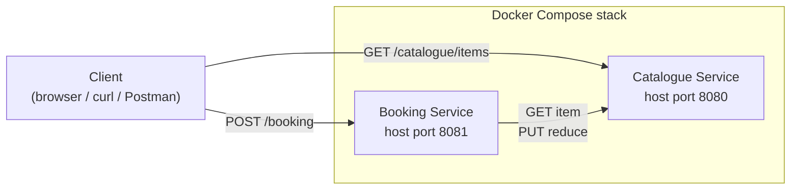

| Actor | Responsibility |
|---|---|
| **Client** | Any HTTP client: browser, curl, Postman, or another service |
| **Booking Service** | Validates requests and orchestrates the booking; calls the Catalogue Service |
| **Catalogue Service** | Owns the item catalogue and enforces stock integrity |

> **Note:** Both ports are published to the host in the default Compose file, which
> means the internal `PUT /reduce` endpoint is also reachable by external clients.
> See [Section 10](#10-known-limitations-and-next-steps).

---

## 2. Container and Deployment View

Each service runs in its own container on a shared user-defined bridge network.
Docker's embedded DNS resolves `catalogue-service` to the container IP.

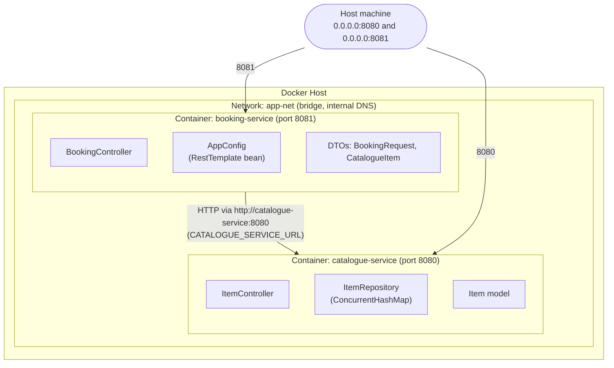

### Inter-service communication

| From | Call | Purpose |
|---|---|---|
| booking-service | `GET /catalogue/items/{id}` | Existence check and current stock |
| booking-service | `PUT /catalogue/items/{id}/reduce?quantity=N` | Atomic stock deduction |

- **Protocol:** plain HTTP; inter-service traffic stays on the virtual `app-net` network.
- **Service discovery:** Docker DNS. The base URL is injected through the
  `CATALOGUE_SERVICE_URL` environment variable (`http://catalogue-service:8080`).
- **HTTP client:** Spring `RestTemplate`, registered as a singleton `@Bean` in `AppConfig`.

---

## 3. Internal Component View

### 3.1 Catalogue Service

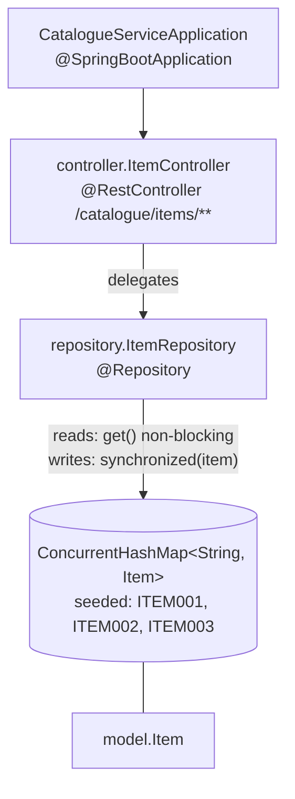

### 3.2 Booking Service

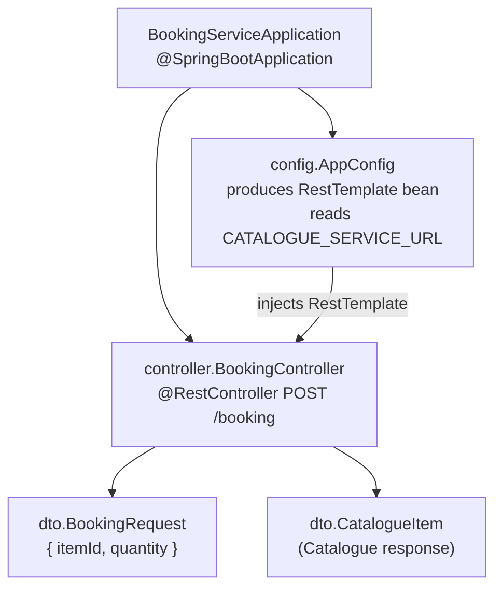

### 3.3 Domain model

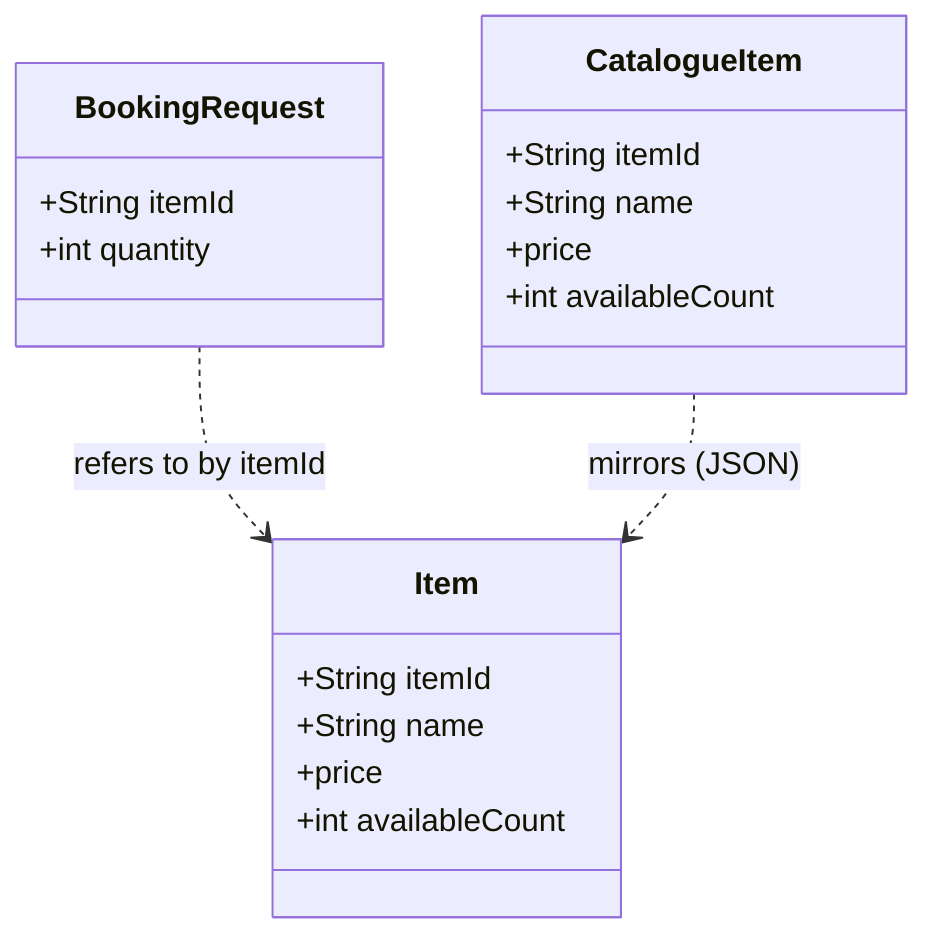

`CatalogueItem` is the Booking Service's own copy of the Catalogue's response
shape. The two services share no code, only the JSON contract.

### 3.4 Booking decision logic

`BookingController` runs four steps. Steps 1 to 3 are cheap guards; step 4 is the
only one that mutates state.

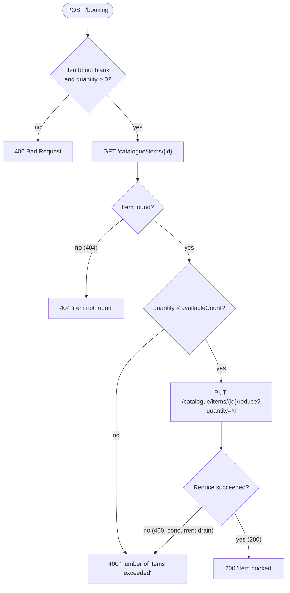

---

## 4. API Reference

### Catalogue Service: `http://localhost:8080`

| Method | Path | Purpose | Caller | Success | Errors |
|---|---|---|---|---|---|
| `GET` | `/catalogue/items` | List all items | Client, health check | `200` JSON array | n/a |
| `GET` | `/catalogue/items/{id}` | Fetch one item | Booking Service | `200` JSON object | `404` not found |
| `PUT` | `/catalogue/items/{id}/reduce?quantity=N` | Atomically deduct stock | Booking Service (internal) | `200` `"stock reduced"` | `400` insufficient stock · `404` not found |

### Booking Service: `http://localhost:8081`

| Method | Path | Purpose | Caller | Success | Errors |
|---|---|---|---|---|---|
| `POST` | `/booking` | Book an item | Client | `200` `"item booked"` | `400` invalid input or `"number of items exceeded"` · `404` `"item not found"` |

**Example**

```bash
curl -X POST http://localhost:8081/booking \
  -H "Content-Type: application/json" \
  -d '{"itemId":"ITEM001","quantity":2}'
# -> 200 item booked
```

---

## 5. Startup Sequence

Docker Compose enforces start order with a health check, so the Booking Service
never starts before the Catalogue Service can answer requests.

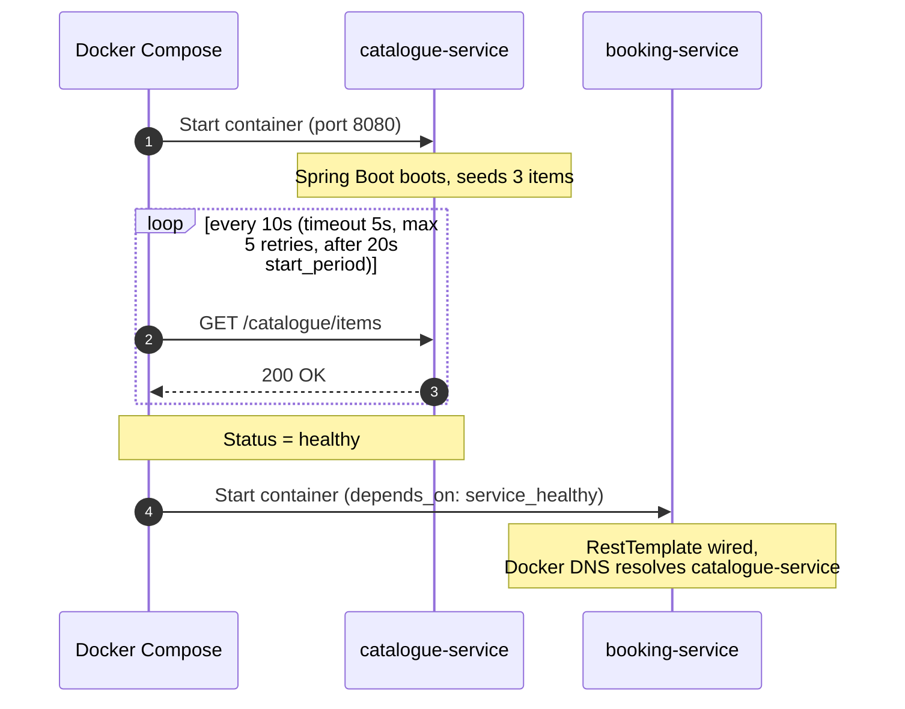

> **Why it matters:** without the health-check dependency, the first booking request
> could hit a Catalogue Service that is still starting and fail with a connection
> error or `503`.

---

## 6. Workflow Walkthroughs

### Scenario A: Successful booking

**Request:** `POST /booking` with `{ "itemId": "ITEM001", "quantity": 2 }`
**Pre-condition:** ITEM001 (Wireless Headphones), `availableCount = 10`

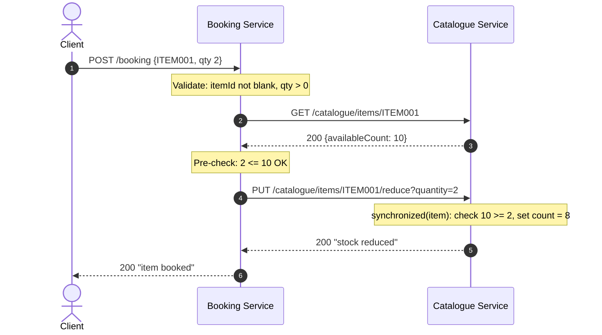

1. The client posts the booking request to port `8081`.
2. `BookingController` validates the input; both checks pass.
3. Booking Service fetches the item from the Catalogue Service over `app-net`.
4. The response is deserialised into `CatalogueItem`; the requested quantity (2) does not exceed stock (10).
5. Booking Service calls `PUT .../reduce?quantity=2`.
6. `ItemRepository.reduceStock()` locks the `Item`, re-checks `10 >= 2`, and sets `availableCount = 8`.
7. `200 "stock reduced"` returns to Booking Service, which replies `200 "item booked"`.

Stock stays at 8 for the lifetime of the container.

### Scenario B: Stock exceeded (short-circuit)

**Request:** `POST /booking` with `{ "itemId": "ITEM002", "quantity": 99 }`
**Pre-condition:** ITEM002 (Mechanical Keyboard), `availableCount = 5`

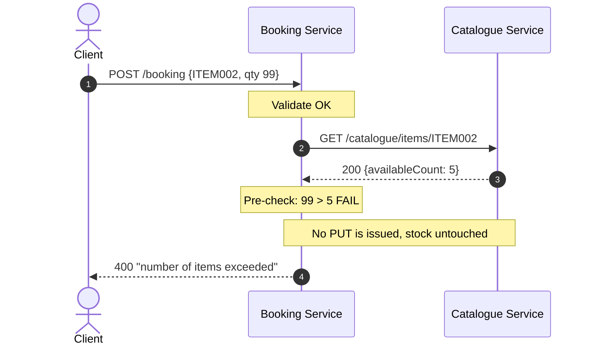

The Booking Service stops at the pre-check, so the Catalogue Service sees no write
and ITEM002 stays at 5.

### Scenario C: Item does not exist

**Request:** `POST /booking` with `{ "itemId": "ITEM999", "quantity": 1 }`

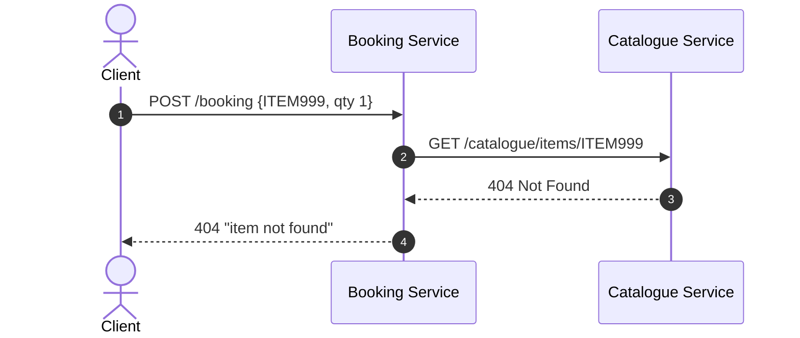

### Scenario D: Concurrent bookings drain stock between check and deduct

**Pre-condition:** ITEM003 has `availableCount = 1`; two clients each request 1 unit.

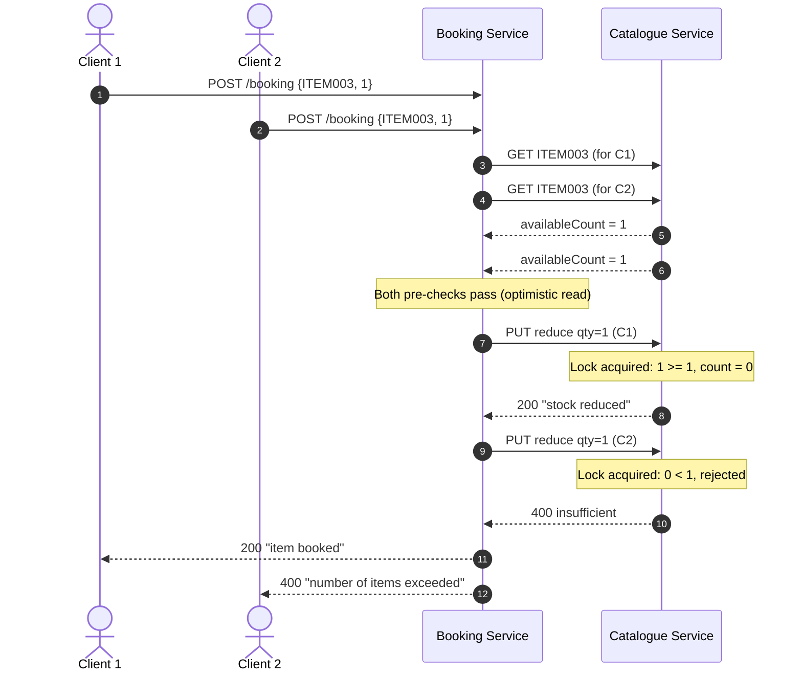

The pre-check is only an optimistic early exit. The authoritative check is inside
`reduceStock()`, so overselling cannot happen.

---

## 7. Concurrency and Thread-Safety Model

The Catalogue Service uses two complementary levels.

| Level | Mechanism | Effect |
|---|---|---|
| 1 | `ConcurrentHashMap` | Threads reading different (or the same) items never block each other |
| 2 | `synchronized(item)` inside `reduceStock()` | The check-then-deduct pair runs atomically per item |

**With the lock** (two concurrent bookings of 2 units, stock = 10):

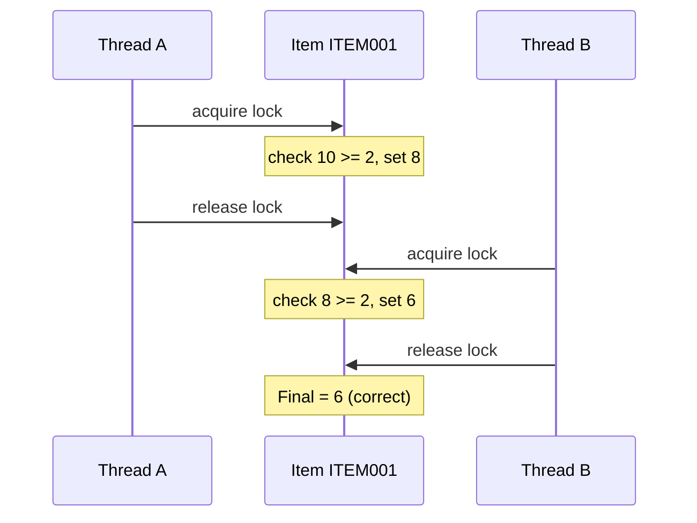

**Without the lock** (race condition): both threads read 10, both pass the check,
both write 8. Final stock is 8 instead of 6, so one unit is given away.

> **Key insight:** the Booking Service pre-check (step 3) is an *optimistic read*.
> The race-safe check lives in `ItemRepository.reduceStock()`. That is why the
> `PUT /reduce` call can still return `400` even after the pre-check passed, and
> why the Booking Service must map that response to `400 "number of items exceeded"`.

**Scope of the guarantee:** per-item locking is correct only for a single JVM and a
single Catalogue replica, and only while the same `Item` instance stays in the map
for the lifetime of the process.

---

## 8. Docker Build Pipeline

Both services use identical multi-stage Dockerfiles.

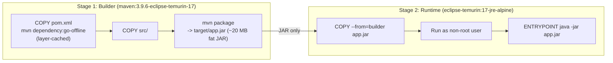

The runtime image has no Maven, no `javac`, and no source code.

| Image | Base | Approx. size (compressed) |
|---|---|:---:|
| `catalogue-service:latest` | `eclipse-temurin:17-jre-alpine` | ~86 MB |
| `booking-service:latest` | `eclipse-temurin:17-jre-alpine` | ~86 MB |

---

## 9. Design Decisions and Trade-offs

| Decision | Choice | Rationale | Trade-off |
|---|---|---|---|
| **Data store** | In-memory `ConcurrentHashMap` | No external dependencies; fast; easy to reason about | Data resets on restart; not suitable for production persistence |
| **Inter-service transport** | Synchronous REST via `RestTemplate` | Standard, language-agnostic, trivially testable with curl | Temporal coupling: Catalogue downtime blocks all bookings |
| **Service discovery** | Docker DNS | Built into Compose; no Consul or Eureka needed | Single Docker network only; not portable to multi-host clusters |
| **Startup ordering** | `depends_on` + health check | Prevents premature calls from Booking Service | Adds ~20 s to startup; not a substitute for retries or circuit breakers |
| **Concurrency control** | `synchronized` on the item object | Fine-grained per-item locking; prevents overselling without DB transactions | Blocking; valid for one JVM and one replica only |
| **Build strategy** | Multi-stage Docker build | No local JDK or Maven needed; lean, secure runtime image | Slower first build (dependency download), cached afterwards |

---

## 10. Known Limitations and Next Steps

| # | Limitation | Suggested improvement |
|---|---|---|
| 1 | `PUT /reduce` is an internal operation but is reachable from the host because port `8080` is published. Any client can deplete stock without going through booking. | Remove the host port mapping for `catalogue-service` (or restrict to `127.0.0.1`), or expose only `GET` routes publicly. |
| 2 | The pre-check (`GET` then compare) duplicates the authoritative check and adds a network round trip. | Keep `GET` only for the `404` distinction and let `reduce` decide stock sufficiency, or drop the quantity pre-check. |
| 3 | `RestTemplate` has no explicit connect/read timeouts, retries, or circuit breaker. A slow Catalogue Service can exhaust Booking threads. | Configure timeouts on the `RestTemplate` bean; add Resilience4j if the system grows. |
| 4 | Booking is not idempotent. A client retry after a timeout can deduct stock twice. | Accept an idempotency key on `POST /booking`. |
| 5 | `PUT /reduce` is a state change on a non-idempotent verb with query parameters. | Prefer `POST /catalogue/items/{id}/reservations` with a body if the API is to be public. |
| 6 | State is lost on restart and cannot be shared across replicas. | Move to a database with conditional updates (`UPDATE ... WHERE available_count >= ?`) to replace the JVM lock. |

---

*Maintained alongside the source code. Update this document whenever endpoints, ports, or the Compose topology change.*
