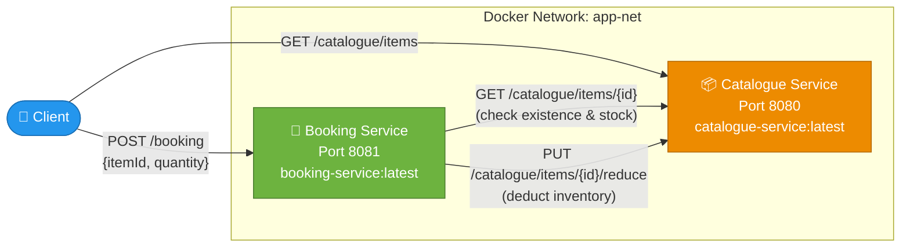

<div align="center">

# 🛍️ Microservices Catalogue Application

**A production-ready, fully containerised Spring Boot microservices system**

[](https://openjdk.org/projects/jdk/17/)
[](https://spring.io/projects/spring-boot)
[](https://maven.apache.org/)
[](https://www.docker.com/)
[](https://docs.docker.com/compose/)

> No JDK · No Maven · No Tomcat required on the host machine at runtime.

---

🎓 **Course Project** — *Internet Technologies (CSS752)*
**Instructor:** Prof. Dr. Suvadip Batabyal

</div>

---

## 📑 Table of Contents

- [Architecture](#-architecture)
- [Catalogue Items](#-catalogue-items-seed-data)
- [Prerequisites & WSL Setup](#-prerequisites--wsl-setup-windows)
- [Project Structure](#-project-structure)
- [Build & Run](#-build--run)
- [API Reference](#-api-reference)
- [Testing All Business Rules](#-testing-all-business-rules)
- [Stop the Application](#-stop-the-application)
- [Transfer to Another Machine](#-transfer-to-another-machine-no-jdkmaven-required)
- [Docker Image Details](#-docker-image-details)
- [Business Rules Summary](#-business-rules-summary)

---

## 🏗️ Architecture



| Layer | Detail |
|---|---|
| **Inter-service transport** | HTTP REST over Docker bridge network `app-net` |
| **Service discovery** | Docker DNS — `catalogue-service` hostname resolves automatically |
| **Data store** | In-memory `ConcurrentHashMap` (thread-safe, no database needed) |
| **Startup order** | Booking Service waits for Catalogue Service health check before starting |

---

## 📦 Catalogue Items (Seed Data)

Three items are pre-loaded at startup. Data resets each time containers restart (in-memory store).

| Item ID  | Name                 | Price (₹) | Initial Stock |
|:--------:|----------------------|----------:|:-------------:|
| `ITEM001` | 🎧 Wireless Headphones | 2,999.99 | 10 |
| `ITEM002` | ⌨️ Mechanical Keyboard | 4,599.00 | 5  |
| `ITEM003` | 🔌 USB-C Hub           |   899.50 | 20 |

---

## ⚙️ Prerequisites & WSL Setup (Windows)

### Required Tools

| Tool | Required? | Why |
|------|:---------:|-----|
| **WSL 2** (Windows Subsystem for Linux) | ✅ **Yes** | Required by Docker Desktop on Windows |
| **Docker Desktop** | ✅ **Yes** | Runs containers |
| **Docker Compose** | ✅ **Yes** | Ships with Docker Desktop |
| JDK | ❌ No | Bundled inside the Docker image |
| Maven | ❌ No | Runs only inside the multi-stage Docker build |
| Tomcat | ❌ No | Embedded in the Spring Boot executable JAR |

---

### 🪟 Step 1 — Install WSL 2 (Windows only)

> **Docker Desktop for Windows requires WSL 2.** You must install it before installing Docker Desktop, otherwise containers will not start.

Open **PowerShell as Administrator** and run:

```powershell
# Install WSL 2 with the default Ubuntu distribution
wsl --install

# After the install completes, restart your PC
# Then verify WSL is running Ubuntu
wsl -l -v
```

Expected output after reboot:
```
  NAME      STATE           VERSION
* Ubuntu    Running         2
```

> If you already have WSL 1, upgrade it: `wsl --set-default-version 2`

---

### 🐳 Step 2 — Install Docker Desktop

1. Download **Docker Desktop for Windows** from [https://www.docker.com/products/docker-desktop](https://www.docker.com/products/docker-desktop)
2. Run the installer — it will detect your WSL 2 installation automatically
3. During setup, ensure **"Use WSL 2 based engine"** is checked ✅
4. After installation, open Docker Desktop and wait for it to show **"Engine running"** in the bottom-left corner
5. Verify in PowerShell:

```powershell
docker --version
docker compose version
```

---

## 📁 Project Structure

```
microservices_catalogue/
│
├── 📂 catalogue-service/
│   ├── src/main/java/com/catalogue/
│   │   ├── CatalogueServiceApplication.java   ← Spring Boot entry point
│   │   ├── controller/ItemController.java      ← REST endpoints (GET, PUT)
│   │   ├── model/Item.java                     ← Domain model
│   │   └── repository/ItemRepository.java      ← In-memory store (3 seed items)
│   ├── src/main/resources/application.properties
│   ├── pom.xml
│   └── Dockerfile                              ← Multi-stage build
│
├── 📂 booking-service/
│   ├── src/main/java/com/booking/
│   │   ├── BookingServiceApplication.java      ← Spring Boot entry point
│   │   ├── config/AppConfig.java               ← RestTemplate bean + URL config
│   │   ├── controller/BookingController.java   ← POST /booking logic
│   │   └── dto/
│   │       ├── BookingRequest.java             ← Request body DTO
│   │       └── CatalogueItem.java              ← Response body DTO
│   ├── src/main/resources/application.properties
│   ├── pom.xml
│   └── Dockerfile                              ← Multi-stage build
│
├── docker-compose.yml                          ← Orchestrates both services
└── README.md
```

---

## 🚀 Build & Run

### Option 1 — Docker Compose (Recommended)

```bash
# Navigate to the project root
cd microservices_catalogue

# Build both images and start all services in the foreground
docker compose up --build

# Or start detached (background)
docker compose up --build -d
```

Both images are built entirely inside Docker using **multi-stage builds** — Maven compiles the code in a temporary builder container; only the final JAR is copied into the slim runtime image. **No local Maven or JDK needed.**

When startup is complete you will see:
```
catalogue-service  | Started CatalogueServiceApplication in X seconds
booking-service    | Started BookingServiceApplication in X seconds
```

### Option 2 — Pre-built Images

See the **[Transfer to Another Machine](#-transfer-to-another-machine-no-jdkmaven-required)** section.

---

## 📡 API Reference

### Catalogue Service — `http://localhost:8080`

| Method | Endpoint | Description | Auth |
|--------|----------|-------------|------|
| `GET` | `/catalogue/items` | List all items | Public |
| `GET` | `/catalogue/items/{id}` | Get a single item by ID | Public |
| `PUT` | `/catalogue/items/{id}/reduce?quantity=N` | Reduce stock atomically | Internal (called by Booking Service) |

**Sample Response — `GET /catalogue/items/ITEM001`:**
```json
{
  "itemId": "ITEM001",
  "name": "Wireless Headphones",
  "price": 2999.99,
  "availableCount": 10
}
```

---

### Booking Service — `http://localhost:8081`

| Method | Endpoint | Body | Description |
|--------|----------|------|-------------|
| `POST` | `/booking` | `{"itemId": "...", "quantity": N}` | Book an item |

**Response values:**

| Condition | HTTP Status | Response Body |
|-----------|:-----------:|---------------|
| Booking successful | `200 OK` | `item booked` |
| Item ID not found | `404 Not Found` | `item not found` |
| Quantity > available stock | `400 Bad Request` | `number of items exceeded` |

---

## 🧪 Testing All Business Rules

> **Make sure the application is running** (`docker compose up -d`) before running these tests.

### 🪟 Windows — PowerShell / Command Prompt

> **Note on `curl` in PowerShell:** In PowerShell, `curl` is an alias for `Invoke-WebRequest` and does **not** accept Unix-style flags like `-H` or `-d`. Use one of the two methods below.

---

#### ✅ Method 1 — `curl.exe` (recommended for quick testing)

`curl.exe` (the real curl binary) ships with Windows 10/11 and works in both PowerShell and Command Prompt:

```powershell
# 1. List all catalogue items
curl.exe http://localhost:8080/catalogue/items

# 2. Get a specific item
curl.exe http://localhost:8080/catalogue/items/ITEM001

# 3. Valid booking → "item booked"
curl.exe -X POST http://localhost:8081/booking -H "Content-Type: application/json" -d "{\"itemId\":\"ITEM001\",\"quantity\":2}"

# 4. Invalid item ID → "item not found"
curl.exe -X POST http://localhost:8081/booking -H "Content-Type: application/json" -d "{\"itemId\":\"BADITEM\",\"quantity\":1}"

# 5. Quantity exceeds stock → "number of items exceeded"
curl.exe -X POST http://localhost:8081/booking -H "Content-Type: application/json" -d "{\"itemId\":\"ITEM002\",\"quantity\":99}"

# 6. Book exact remaining stock (ITEM002 has 5) → "item booked"
curl.exe -X POST http://localhost:8081/booking -H "Content-Type: application/json" -d "{\"itemId\":\"ITEM002\",\"quantity\":5}"

# 7. Book again after stock = 0 → "number of items exceeded"
curl.exe -X POST http://localhost:8081/booking -H "Content-Type: application/json" -d "{\"itemId\":\"ITEM002\",\"quantity\":1}"

# 8. Repeated bookings — run multiple times, stock decreases each time
curl.exe -X POST http://localhost:8081/booking -H "Content-Type: application/json" -d "{\"itemId\":\"ITEM003\",\"quantity\":3}"
curl.exe http://localhost:8080/catalogue/items/ITEM003
```

---

#### ✅ Method 2 — `Invoke-RestMethod` (native PowerShell)

If `curl.exe` is not available, use PowerShell's built-in `Invoke-RestMethod`:

```powershell
# 1. List all catalogue items
Invoke-RestMethod http://localhost:8080/catalogue/items

# 2. Get a specific item
Invoke-RestMethod http://localhost:8080/catalogue/items/ITEM001

# 3. Valid booking → "item booked"
Invoke-RestMethod -Uri "http://localhost:8081/booking" -Method POST `
  -Headers @{"Content-Type"="application/json"} `
  -Body '{"itemId":"ITEM001","quantity":2}'

# 4. Invalid item ID → "item not found"
try {
  Invoke-RestMethod -Uri "http://localhost:8081/booking" -Method POST `
    -Headers @{"Content-Type"="application/json"} `
    -Body '{"itemId":"BADITEM","quantity":1}'
} catch { $_.ErrorDetails.Message }

# 5. Quantity exceeds stock → "number of items exceeded"
try {
  Invoke-RestMethod -Uri "http://localhost:8081/booking" -Method POST `
    -Headers @{"Content-Type"="application/json"} `
    -Body '{"itemId":"ITEM002","quantity":99}'
} catch { $_.ErrorDetails.Message }

# 6. Book exact remaining stock (ITEM002 has 5) → "item booked"
Invoke-RestMethod -Uri "http://localhost:8081/booking" -Method POST `
  -Headers @{"Content-Type"="application/json"} `
  -Body '{"itemId":"ITEM002","quantity":5}'

# 7. Book again after stock = 0 → "number of items exceeded"
try {
  Invoke-RestMethod -Uri "http://localhost:8081/booking" -Method POST `
    -Headers @{"Content-Type"="application/json"} `
    -Body '{"itemId":"ITEM002","quantity":1}'
} catch { $_.ErrorDetails.Message }
```

> **Tip:** PowerShell wraps non-2xx responses in exceptions. Wrap `Invoke-RestMethod` calls in `try/catch` and read `$_.ErrorDetails.Message` to see the error body (e.g., `"item not found"`).

---

#### ✅ Method 3 — Linux / macOS / WSL Terminal (standard curl)

```bash
# 1. List all catalogue items
curl http://localhost:8080/catalogue/items

# 2. Get a specific item
curl http://localhost:8080/catalogue/items/ITEM001

# 3. Valid booking → "item booked"
curl -X POST http://localhost:8081/booking \
     -H "Content-Type: application/json" \
     -d '{"itemId":"ITEM001","quantity":2}'

# 4. Invalid item ID → "item not found"
curl -X POST http://localhost:8081/booking \
     -H "Content-Type: application/json" \
     -d '{"itemId":"BADITEM","quantity":1}'

# 5. Quantity exceeds stock → "number of items exceeded"
curl -X POST http://localhost:8081/booking \
     -H "Content-Type: application/json" \
     -d '{"itemId":"ITEM002","quantity":99}'

# 6. Book exact remaining stock (ITEM002 has 5) → "item booked"
curl -X POST http://localhost:8081/booking \
     -H "Content-Type: application/json" \
     -d '{"itemId":"ITEM002","quantity":5}'

# 7. Book again after stock = 0 → "number of items exceeded"
curl -X POST http://localhost:8081/booking \
     -H "Content-Type: application/json" \
     -d '{"itemId":"ITEM002","quantity":1}'

# 8. Repeated bookings — stock decreases each time
for i in 1 2 3; do
  curl -s -X POST http://localhost:8081/booking \
       -H "Content-Type: application/json" \
       -d '{"itemId":"ITEM003","quantity":3}'
  echo " — booking $i done"
done
curl http://localhost:8080/catalogue/items/ITEM003   # verify stock dropped to 11
```

---

### 📊 Expected Responses at a Glance

| Test Scenario | HTTP Status | Response Body |
|---|:---:|---|
| ✅ Valid booking | `200` | `item booked` |
| ❌ Item ID doesn't exist | `404` | `item not found` |
| ❌ Requested qty > available | `400` | `number of items exceeded` |
| ❌ Book when stock = 0 | `400` | `number of items exceeded` |

---

## 🛑 Stop the Application

```bash
# Stop and remove containers (inventory resets on next start)
docker compose down

# Stop containers but keep them (faster restart)
docker compose stop

# Start stopped containers (no rebuild)
docker compose start
```

---

## 📤 Transfer to Another Machine (No JDK/Maven Required)

The target machine only needs **Docker** installed. No JDK, Maven, or Tomcat.

### Method A — Save & Load Docker Images *(Best for offline / air-gapped environments)*

**On the source machine** (where images were built):
```bash
# Package both images into a single tar file (~172 MB)
docker save catalogue-service:latest booking-service:latest \
  -o microservices-images.tar
```

Transfer `microservices-images.tar` + `docker-compose.yml` to the target machine via USB, SCP, cloud storage, etc.

**On the target machine**:
```bash
# Load both images into Docker
docker load -i microservices-images.tar

# Verify
docker images | grep -E "catalogue-service|booking-service"

# Start (images are already loaded — no build needed)
docker compose up -d
```

---

### Method B — Rebuild from Source *(Requires internet on target machine)*

```bash
# Copy the entire microservices_catalogue/ directory to the target machine
# Maven + JDK will run inside Docker during the build — nothing to install
docker compose up --build -d
```

---

### Method C — Docker Hub / Private Registry *(Best for team sharing)*

```bash
# ── Source machine ────────────────────────────────────────────
docker tag catalogue-service:latest YOUR_DOCKERHUB_USER/catalogue-service:1.0.0
docker tag booking-service:latest   YOUR_DOCKERHUB_USER/booking-service:1.0.0
docker push YOUR_DOCKERHUB_USER/catalogue-service:1.0.0
docker push YOUR_DOCKERHUB_USER/booking-service:1.0.0

# ── Target machine (only Docker needed) ───────────────────────
docker pull YOUR_DOCKERHUB_USER/catalogue-service:1.0.0
docker pull YOUR_DOCKERHUB_USER/booking-service:1.0.0
# Update image names in docker-compose.yml, then:
docker compose up -d
```

---

## 🐳 Docker Image Details

| Image | Base Runtime Image | Compressed Size |
|---|---|:---:|
| `catalogue-service:latest` | `eclipse-temurin:17-jre-alpine` | ~86 MB |
| `booking-service:latest` | `eclipse-temurin:17-jre-alpine` | ~86 MB |

### Multi-Stage Build Flow

```
┌─────────────────────────────────────────────────────────────┐
│  Stage 1 — Builder  (maven:3.9.6-eclipse-temurin-17)        │
│                                                             │
│  1. Download dependencies (cached by Docker layer)          │
│  2. Compile Java source → .class files                      │
│  3. Package into executable fat JAR                         │
│                              │                              │
│              ┌───────────────┘ Only the JAR is copied       │
│              ▼                                              │
│  Stage 2 — Runtime  (eclipse-temurin:17-jre-alpine)         │
│                                                             │
│  • Slim JRE only (~86 MB)  • No Maven  • No full JDK        │
│  • No source code          • Runs as non-root user          │
└─────────────────────────────────────────────────────────────┘
```

---

## 📋 Business Rules Summary

| # | Rule | Trigger | Response |
|---|------|---------|----------|
| 1 | **Item Not Found** | `itemId` does not exist in the catalogue | `"item not found"` (HTTP 404) |
| 2 | **Number of Items Exceeded** | `quantity` > current `availableCount` | `"number of items exceeded"` (HTTP 400) |
| 3 | **Item Booked** | Sufficient stock available | `"item booked"` (HTTP 200), stock reduced atomically |

> **Thread Safety:** Stock reduction uses a `synchronized` block on each item object, preventing overselling even under concurrent requests.

---

<div align="center">

**Built with ❤️ using Java 17 · Spring Boot 3 · Docker**

[](https://openjdk.org/)
[](https://spring.io/)
[](https://www.docker.com/)
[](https://maven.apache.org/)

</div>
